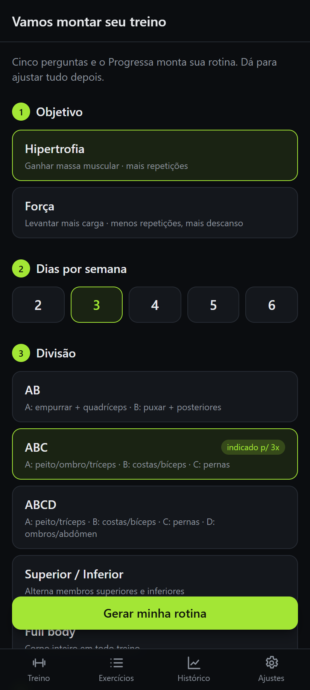
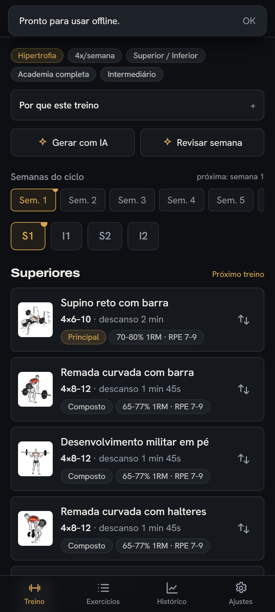
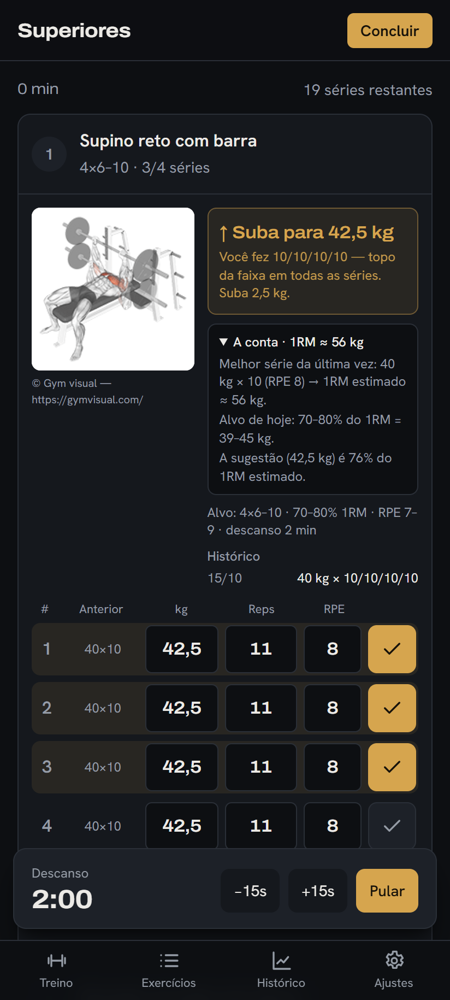
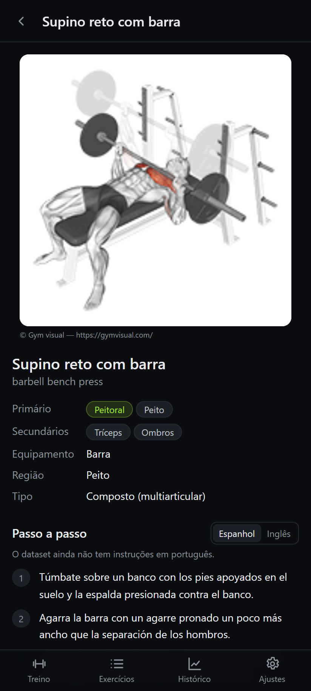
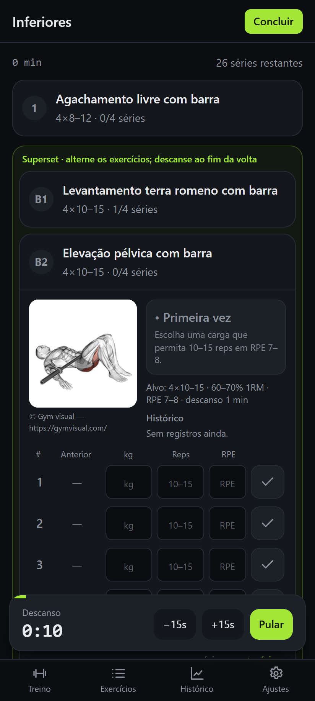
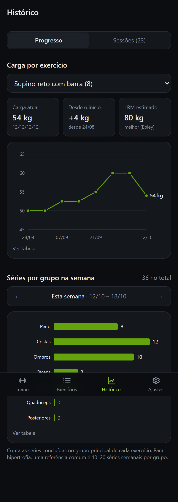
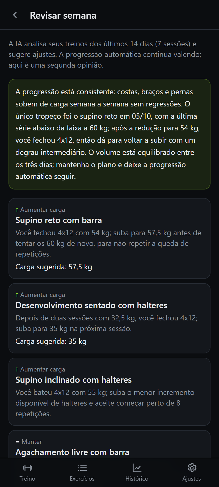

# Progressa

App de treino de musculação (PWA) em português: monta o programa pelo seu objetivo, registra as séries e
sugere a carga da próxima sessão. Roda no navegador, instala no Android e funciona offline. Sem backend:
seus dados ficam no aparelho.

**App:** https://p-libano.github.io/progressa/

| Objetivo e perfil | Programa | Sessão | Exercício |
|---|---|---|---|
|  |  |  |  |

| Superset e finisher | Histórico | Revisão com IA |
|---|---|---|
|  |  |  |

## O que faz

- **5 objetivos com programas diferentes de verdade:** força máxima, hipertrofia, gasto energético
  (recomposição), resistência muscular e força + hipertrofia. Cada um muda a escolha e a ordem dos
  exercícios, séries × reps, descanso, intensidade (%1RM e RPE), volume semanal por grupo e a regra de
  progressão. Detalhes em [`docs/programacao.md`](docs/programacao.md).
- **Divisões** AB, ABC, ABCD, superior/inferior e full body, de 2 a 6 dias; equipamento (academia, só
  halteres, peso corporal, com ou sem barra fixa) e nível (iniciante, intermediário, avançado).
- **Periodização:** força e força + hipertrofia em blocos de 3 semanas subindo a carga + 1 de deload; os
  demais com deload quando a progressão trava e um deload planejado a cada 6 semanas.
- **Sessão de treino:** GIF de execução, cronômetro de descanso (sobrevive a recarregar a página), carga,
  reps e RPE por série, histórico ao lado, supersets/circuitos/finisher.
- **Progressão automática por objetivo:** carga guiada por RPE (força), dupla progressão (hipertrofia),
  densidade — menos descanso, depois mais séries, só então carga (gasto energético) — e reps antes de carga
  (resistência).
- **"Por que este treino":** cada programa explica faixa de reps, descanso, progressão e o que esperar em
  4–8 semanas, sem promessas sem base (o app varre os próprios textos atrás de frases como "acelera o
  metabolismo").
- **A conta à vista:** cada exercício mostra o 1RM estimado da última sessão, a faixa em kg que a prescrição pede e onde
  a sugestão cai. Na primeira vez, informe um peso × reps que você já faz e o app calcula a carga de partida.
- **Guia** (Ajustes → Guia): 1RM, RPE, as contas do app e o volume, explicados sem jargão.
- **Trocar exercício** por outro do mesmo movimento/grupo e equipamento.
- **Histórico:** volume levantado (peso × reps) por semana, gráfico de carga por exercício (com 1RM estimado) e
  séries semanais por grupo muscular. O fim de cada treino compara o volume com a última vez do mesmo dia.
- **Backup** em JSON (exportar/importar) e **IA opcional** com a sua chave da Claude API.

## Rodar localmente

Requisitos: Node 22 (ver `.nvmrc`).

```bash
npm ci
npm run dev        # http://localhost:5173
npm test           # vitest (inclui a auditoria de prescrição em tests/programacao/)
npm run build      # tsc + vite build em dist/ (base /progressa/)
npm run preview    # serve o build em http://localhost:4173/progressa/ (com service worker)
```

O primeiro acesso baixa a base de exercícios (~1,5 MB comprimido) do jsDelivr; depois ela fica no
IndexedDB e o app funciona offline.

## Instalar no Android

Abra o app no Chrome → menu ⋮ → **Instalar app** (ou "Adicionar à tela inicial"). Os GIFs dos exercícios
ficam guardados conforme você os vê, para usar sem internet na academia.

## IA opcional (Claude API)

O app funciona 100% sem IA. Com uma chave da Claude API ele também pode:

- **Gerar rotina com IA** — envia seu perfil e a lista resumida de exercícios disponíveis; a resposta (JSON)
  é validada com zod e pelas regras do app antes de você decidir usar.
- **Revisar semana** — envia as sessões das últimas 2 semanas e recebe ajustes com justificativa curta.

Como configurar:

1. Crie uma chave em https://console.anthropic.com/settings/keys.
2. No app, abra **Ajustes → IA (opcional)**, cole a chave e toque em **Salvar**.

A chave fica **só no IndexedDB do aparelho**, não entra no backup e é enviada apenas para a API da
Anthropic (`api.anthropic.com`), direto do navegador. O uso é cobrado na sua conta da API (cerca de
US$ 0,05 por pedido, modelo `claude-opus-5-5`). Remova a chave em Ajustes quando quiser.

Teste ao vivo opcional (custa centavos; nunca grave a chave em arquivo):

```bash
PROGRESSA_LIVE_KEY=sk-ant-... npx vitest run src/ai/ai.live.test.ts
```

## Deploy

- `.github/workflows/ci.yml` — testes e build em todo pull request.
- `.github/workflows/deploy.yml` — testes, build e publicação no GitHub Pages a cada push na `main`
  (em **Settings → Pages**, a fonte deve ser **GitHub Actions**). O caminho base vem do nome do repositório
  (`BASE_PATH=/<repo>/`).

## Dados e créditos

- Exercícios: [hasaneyldrm/exercises-dataset](https://github.com/hasaneyldrm/exercises-dataset) — dados sob
  licença MIT. Nomes em português e metadados de programação são do catálogo curado deste app
  (`src/data/curated.ts`, `src/programacao/meta.ts`).
- Imagens e GIFs: **© Gym visual — https://gymvisual.com/**, redistribuídos pelo dataset com permissão e
  carregados direto do CDN. O uso dessa mídia segue os termos da Gym visual; para publicar ou vender um
  derivado, confira a licença com eles.
- O app não substitui orientação profissional.

## Estrutura

```
src/
  data/          catálogo (download, curadoria pt-BR, busca)
  programacao/   objetivos (GoalProfile), gerador, progressão, explicação, migração
  domain/        sessão, estatísticas, substitutos
  ai/            camada de IA (prompts, validação zod, cliente)
  pages/         telas
tests/programacao/  auditoria de prescrição, gerador (todas as combinações), progressão, migração
```
